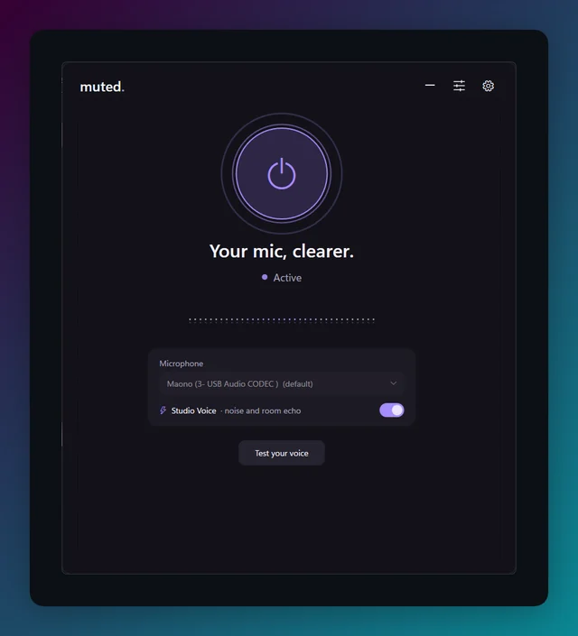
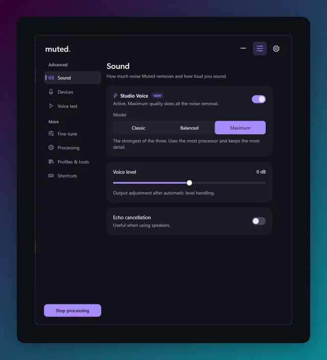
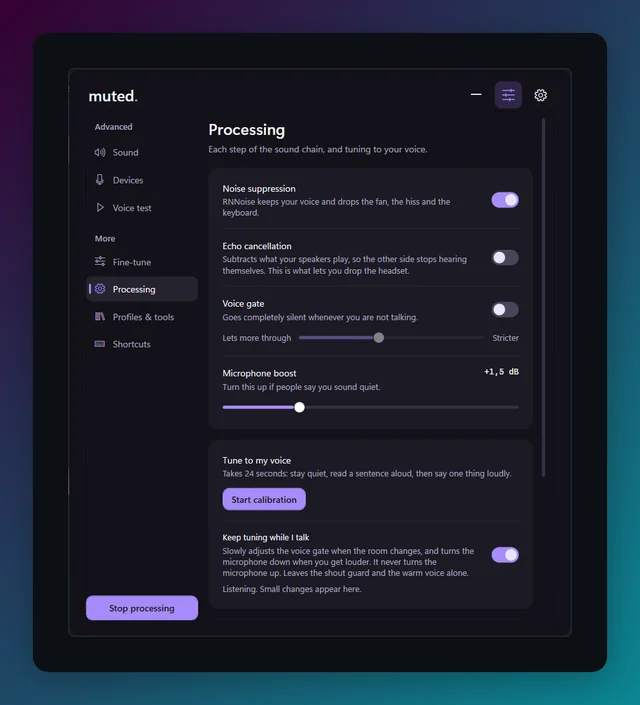
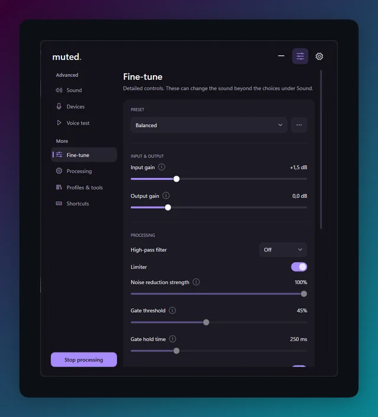

# Muted

[](https://github.com/yyyutakaaa/Muted/releases/latest)
[](https://github.com/yyyutakaaa/Muted/releases)
[](https://github.com/yyyutakaaa/Muted/actions/workflows/ci.yml)
[](LICENSE)

Muted is a small Windows app that runs your microphone through
[RNNoise](https://github.com/xiph/rnnoise), locally, before Discord, Teams, or
your game ever hears the signal. Fan noise, mic hiss, and keyboard clatter get
filtered out along the way. Studio Voice goes further and takes out room
echo as well. It can clean what you hear from others too.

<p align="center">
  
</p>

**[Download the installer](https://github.com/yyyutakaaa/Muted/releases/latest)** ·
free, no account, no cloud, no telemetry.

## Screenshots

The home screen is the only thing most people need. The Advanced page has the
rest.

| Sound | Processing | Fine-tune |
|-------|------------|-----------|
|  |  |  |

The version number sits in the bottom right corner of the window, on every page.

## Why Muted

|                                   | Muted | NVIDIA Broadcast | Krisp        |
|-----------------------------------|-------|------------------|--------------|
| Works on any PC, no RTX card      | yes   | no, needs RTX    | yes          |
| No account or sign-in             | yes   | yes              | no           |
| Free without time limits          | yes   | yes              | paid plans   |
| Source code you can read          | yes   | no               | no           |
| Cleans your microphone            | yes   | yes              | yes          |
| Cleans what you hear              | yes   | yes              | yes          |
| Echo cancellation for speakers    | yes   | yes              | yes          |

Muted needs a virtual audio cable, like the free VB-CABLE, because Windows only
lets signed drivers add a new microphone. The setup guide inside the app walks
you through it.

## Install

- **Installer**: grab `Muted-Setup-x.y.z.exe` from the
  [latest release](https://github.com/yyyutakaaa/Muted/releases/latest). It
  updates itself.
- **Scoop**:

  ```powershell
  scoop bucket add muted https://github.com/yyyutakaaa/Muted
  scoop install muted/muted
  ```

- **Portable**: unzip `Muted-win-x64.zip` anywhere and run `Muted.exe`.

## Getting started

Muted opens with a four-step setup guide the first time; it walks through the same steps as below.

Windows only lets an app publish a new, selectable microphone through a
signed audio driver, and that's not something Muted ships. So it relies on a
virtual cable you've already installed, like [VB-CABLE](https://vb-audio.com/Cable/).

1. Install a signed virtual audio cable, and restart Windows if the installer
   asks for it.
2. Start Muted.
3. Pick your real microphone under **Microphone**.
4. Pick the cable's playback side under **Cable output**, usually
   `CABLE Input` or `CABLE In 16ch` for VB-CABLE.
5. Hit the power button.
6. In Discord, Teams, Zoom, or your game, select the cable's recording side as
   your microphone, usually `CABLE Output` or `CABLE Out 16ch` for VB-CABLE.

Muted deliberately refuses to start into regular speakers or a headset.
Without that guard, a missing cable at autostart could quietly feed your own
output back into your microphone. Full setup, the 48 kHz requirement, and
troubleshooting live in [docs/VIRTUAL-CABLE.md](docs/VIRTUAL-CABLE.md).

Turn off your call app's built-in noise suppression if you hear pumping or
distortion. Two suppressors stacked on top of each other don't always beat
one.

## Features

- **Studio Voice**: AI noise removal that also removes room echo. Switch it on
  from the home screen, and pick Classic, Balanced or Maximum under Advanced,
  Sound. If a model can't load, the standard noise suppression keeps working.
- **Noise suppression** with the official, pinned Xiph RNNoise model, at 48 kHz
  with 20 ms of delay.
- **Echo cancellation**, so you can use speakers instead of a headset.
- **Voice gate, automatic level, high-pass and a limiter**, plus a shout guard
  that catches a shout before its first loud sample.
- **Tune to my voice**: a 24-second calibration that sets boost, gate and limits
  for you, and can keep adjusting while you talk.
- **Voice presets and profiles**, which can switch on their own while a game or
  call app runs.
- **Push to talk, push to mute** and other global shortcuts that work in
  full-screen games, plus commands for Stream Deck, OBS and scripts.
- **Clean what you hear**: the same model on other people's audio.
- **Recordings and before/after clips**, kept in memory until you save them.
- **An in-game indicator**, tray controls, a setup check and automatic updates.

The full tour, with where to find each setting, is in
[docs/FEATURES.md](docs/FEATURES.md).

## Requirements

- Windows 10 or 11, x64.
- A virtual audio cable, such as the free
  [VB-CABLE](https://vb-audio.com/Cable/).

The installer and the portable zip include everything else.

## Documentation

- [Features](docs/FEATURES.md): everything Muted does and where to find it.
- [Virtual cable guide](docs/VIRTUAL-CABLE.md): setup, the 48 kHz requirement
  and troubleshooting.
- [Architecture](docs/ARCHITECTURE.md): how the audio path works, and what a
  real driver would take.
- [Changelog](CHANGELOG.md): what changed in each version.
- [Nederlandstalige uitleg](docs/nl/UITLEG.md): wat Muted doet, in het Nederlands.

## Privacy

Muted processes your audio on your own PC. It has no account and no telemetry,
and it never uploads audio. Recordings stay in memory until you save one
yourself.

The only network request Muted makes on its own is the update check: when it
starts, it asks the public GitHub API whether a newer release exists. That
request carries no personal data, only what every web request does, such as
your IP address. Downloading an update happens only after you approve it.
GitHub's [privacy statement](https://docs.github.com/site-policy/privacy-policies/github-general-privacy-statement)
applies to that request. **Report a problem** opens a pre-filled bug report in
your browser; nothing is sent until you submit it yourself.

## Contributing

Bug reports, ideas and pull requests are welcome. In Muted, **Settings → Check
setup → Report a problem** opens a bug report with your setup filled in. For questions, use
[Discussions](https://github.com/yyyutakaaa/Muted/discussions).

To build it yourself:

```powershell
dotnet build .\Muted.sln -c Release
dotnet test .\Muted.sln -c Release
```

See [CONTRIBUTING.md](CONTRIBUTING.md) for the details, and
[SECURITY.md](SECURITY.md) to report a security problem privately.

## Support

Muted is free and always will be. If it's useful to you, a coffee helps keep
it maintained: [buymeacoffee.com/yyyutakaaa](https://www.buymeacoffee.com/yyyutakaaa).

## License

Muted is source available under the
[PolyForm Noncommercial License 1.0.0](LICENSE). You can read the code, use
Muted for yourself, and build on it for noncommercial purposes. Keep the
copyright notice and a copy of the license with it. You may not use it
commercially, or sell it, without my permission. For that, open a
[discussion](https://github.com/yyyutakaaa/Muted/discussions) or contact me.

Versions up to and including 0.9.1 were released under the MIT License, and
those releases stay MIT.

RNNoise (BSD-3-Clause), NAudio (MIT) and the other bundled components keep their
own licenses, see [THIRD-PARTY-NOTICES.md](THIRD-PARTY-NOTICES.md) and the
`licenses` folder.
